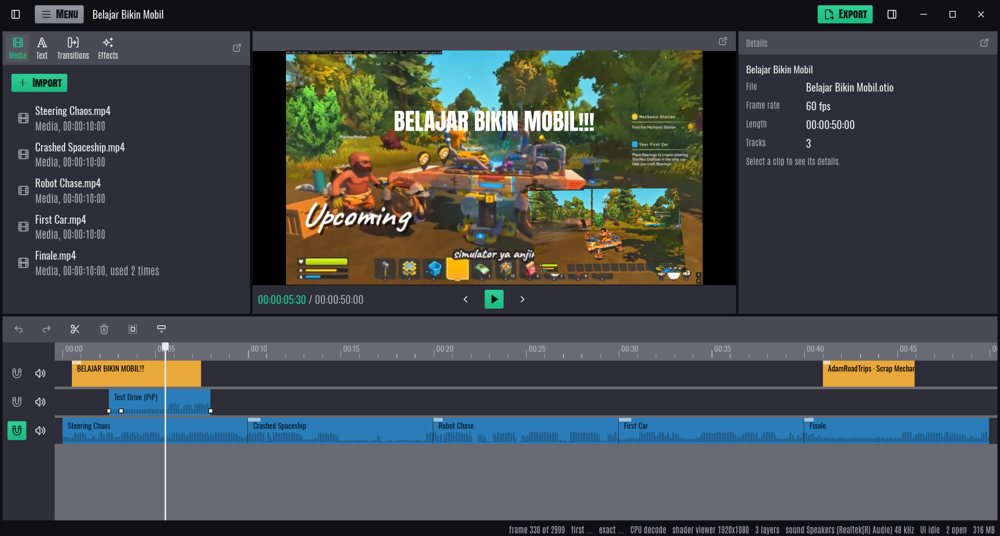
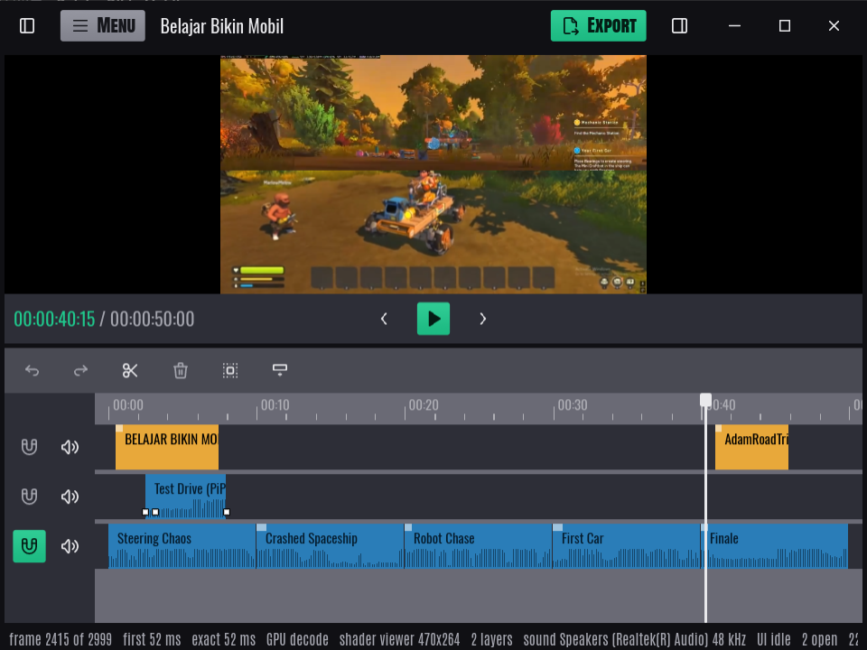

<h1 align="center">cannotcut</h1>

<p align="center">
  <b>A fast, no-nonsense video editor, written in Rust.</b><br>
  Scrub straight from your footage, layer and keyframe clips, add titles and transitions, export to MP4.
</p>

<p align="center">
  <a href="https://github.com/adamvirtualspace-lab/cannotcut/actions/workflows/windows.yml"></a>
  
  
  
  <a href="#licences"></a>
</p>

<p align="center">
  <br>
  <sub>Three tracks: a title and a keyframed picture-in-picture layered over gameplay from
  <a href="https://www.youtube.com/watch?v=_KMj_SG7-Vc">AdamRoadTrips</a>.</sub>
</p>

## Why cannotcut

- **No proxies, no waiting.** Clips scrub straight from the source file. The decoder chases the
  latest frame you asked for, showing the nearest keyframe at once and then the exact frame.
- **The GPU does the drawing.** Hardware decoding (D3D11VA) where the machine has it, and a
  shader turns the decoder's YUV planes into the picture, so no pixel is converted on the CPU.
  There is a CPU fallback for machines without a usable GPU.
- **Sound keeps the time.** Playback is clocked by the sound card, so picture and sound cannot
  drift apart, and a built-in sync test lines up Bluetooth or slow speakers with the picture.
- **Open project files.** Projects are plain [OpenTimelineIO](https://opentimeline.io) (`.otio`),
  so other tools can read them, and anything cannotcut does not understand is carried through
  unchanged.

## Features

<p align="center">
  <br>
  <sub>In a small window the side panels fold away into the top bar. Here a wipe brings in the next shot from the bottom.</sub>
</p>

**Editing**
- Multi-track timeline: move, trim, split (<kbd>Ctrl</kbd>+<kbd>B</kbd>) and delete clips, with
  ripple editing on magnetic tracks that close up their gaps
- Select with <kbd>Ctrl</kbd>/<kbd>Shift</kbd>+click or by drawing a rectangle over clips
- Undo and redo, 500 steps deep
- Waveforms drawn along every clip, as loud as they will play; per-clip volume and track mute

**Layers and motion**
- Stack video tracks; each clip can be moved, scaled, rotated, skewed and faded over what is below
- Keyframe any of that over the length of a clip
- Transitions: dissolve, and wipes from the left, right, top or bottom
- Text titles in three display faces (Anton SC, Antonio, Oswald), sized freely, in eight colours
- Speed changes from 0.1× to 10×

**Projects**
- Nest projects: use one project as a clip in another, either linked to its own `.otio` (changes
  show everywhere it is used) or kept inside as a compound clip
- Export to MP4 (H.264 + AAC) at sizes up to 4K, using the GPU's encoder where there is one
  (AMD AMF, Windows Media Foundation) and OpenH264 otherwise

**Workspace**
- Dockable panels: drag any panel by its title bar to rearrange the layout, or pop it out into a
  window of its own, which reopens where you left it
- Hide either side panel with the button at its end of the top bar (<kbd>Ctrl</kbd>+<kbd>[</kbd> /
  <kbd>Ctrl</kbd>+<kbd>]</kbd>) to give the viewer the room; it comes back where it was
- Fits small screens down to 640p: side panels slide out over the viewer instead of crowding it
- Full-screen viewer (<kbd>F11</kbd> on a popped-out viewer)
- Pick the sound output, with a per-output delay you can set by eye or measure with the microphone
- Choose the accent colour (eight to pick from, or any as `#rrggbb`), the fonts (Condensed,
  Segoe UI, Inter or Roboto), the size of everything (80% to 150%) and the text size (90% to
  125%) under *Menu → Appearance*
- Buttons answer at once and flash a white splash round them when clicked; side panels glide shut
  and open, menus wipe open and closed and dialogs ease in, at the display's own frame rate.
  Motion can be turned off under *Appearance*
- Live readouts of decode latency, layers, how smoothly the window is drawn (UI fps) and memory
  along the bottom

**Coming:** colour and filters (the Effects tab).

## Keyboard shortcuts

| Keys | Does |
|---|---|
| <kbd>Space</kbd> | Play / pause |
| <kbd>←</kbd> <kbd>→</kbd> | Step one frame |
| <kbd>Home</kbd> <kbd>End</kbd> | Jump to the start / end |
| <kbd>Ctrl</kbd>+<kbd>B</kbd> | Split the clip under the playhead |
| <kbd>Delete</kbd> / <kbd>Backspace</kbd> | Delete the selected clips |
| <kbd>Ctrl</kbd>+<kbd>Z</kbd> | Undo |
| <kbd>Ctrl</kbd>+<kbd>Y</kbd> / <kbd>Ctrl</kbd>+<kbd>Shift</kbd>+<kbd>Z</kbd> | Redo |
| <kbd>Ctrl</kbd>+<kbd>N</kbd> / <kbd>O</kbd> / <kbd>S</kbd> | New / open / save project |
| <kbd>Ctrl</kbd>+wheel | Zoom the timeline |
| <kbd>Ctrl</kbd>+<kbd>[</kbd> / <kbd>]</kbd> | Hide or show the media / details panel |
| <kbd>F11</kbd> | Full-screen viewer (when popped out) |
| <kbd>Esc</kbd> | Close a dialog, leave full screen, or step out of a nested project |

## Download

Every push to `main` is built, tested and packaged by
[GitHub Actions](https://github.com/adamvirtualspace-lab/cannotcut/actions/workflows/windows.yml?query=branch%3Amain).
Open the latest green run and download **cannotcut-windows-…** under *Artifacts*. Unzip it and
run `cannotcut.exe`, keeping the `.dll` files beside it.

## Building from source

cannotcut is developed on Windows 10 and 11 (x64). You need:

| What | Why | Where |
|---|---|---|
| Rust (stable, 1.85 or newer) | the 2024 edition | [rustup](https://rustup.rs) |
| Visual Studio Build Tools: *MSVC x64* and a *Windows SDK* | Rust's linker on Windows | [Build Tools](https://visualstudio.microsoft.com/visual-cpp-build-tools/) |
| LLVM | `libclang`, which generates the FFmpeg bindings | [LLVM releases](https://github.com/llvm/llvm-project/releases) (`LLVM-…-win64.exe`) |
| FFmpeg 8.x, **LGPL, shared** | decoding and encoding | [FFmpeg-Builds](https://github.com/BtbN/FFmpeg-Builds/releases/tag/latest) (`ffmpeg-n8.1-latest-win64-lgpl-shared-8.1.zip`) |

Use an **LGPL** build of FFmpeg, not GPL: the app ships FFmpeg's DLLs under the LGPL 3.0.
Unzip it somewhere (for example `C:\dev\ffmpeg`), then set, for your user:

```powershell
[Environment]::SetEnvironmentVariable('FFMPEG_DIR', 'C:\dev\ffmpeg', 'User')
[Environment]::SetEnvironmentVariable('LIBCLANG_PATH', 'C:\Program Files\LLVM\bin', 'User')
# So the app finds FFmpeg's DLLs when run from target\
[Environment]::SetEnvironmentVariable('Path', [Environment]::GetEnvironmentVariable('Path', 'User') + ';C:\dev\ffmpeg\bin', 'User')
```

Open a new terminal, then:

```powershell
cargo run --release -p cannotcut-app          # build and start the editor
cargo test --workspace                        # run the tests
powershell -ExecutionPolicy Bypass -File package.ps1   # zip it up in target\dist
```

The first build compiles a few hundred crates and takes 10 to 15 minutes; later ones take
seconds to a minute.

**After changing dependencies**, regenerate the list of Rust libraries the app ships (shown under
*Menu → About and licences*). CI fails if it is out of date:

```powershell
python crates/cannotcut-app/licences/rust_libraries.py           # rewrite it
python crates/cannotcut-app/licences/rust_libraries.py --check   # only check
```

<details>
<summary><b>Troubleshooting</b></summary>

- **`cargo` hangs on "Updating crates.io index"** or downloads time out: often a network whose
  IPv6 is broken. Fewer, more patient connections help; in `%USERPROFILE%\.cargo\config.toml`:
  ```toml
  [http]
  multiplexing = false
  timeout = 60
  [net]
  retry = 10
  ```
- **`ffmpeg-sys-next` fails to build**: check that `FFMPEG_DIR` points at the folder holding
  `include\` and `lib\`, and that `LIBCLANG_PATH` holds `libclang.dll`. Terminals opened before
  setting them do not see them.
- **The app will not start, missing `avcodec-62.dll`**: FFmpeg's `bin` folder is not on `PATH`,
  or copy its DLLs beside `cannotcut.exe`.

</details>

## Command line

```text
cannotcut [project.otio] [media files…] [options]
```

| Option | Does |
|---|---|
| `project.otio` | Opens the project |
| *media files* | Adds them to the end of the main track |
| `--add=<file>` | Adds a file as a clip; for a project, puts it in as a nested clip instead of opening it |
| `--at=<frame>` | Starts with the playhead on that frame |
| `--play` | Starts playing as soon as the project is open |
| `--export=<film.mp4>` | Exports the project as soon as it is open, without asking where |
| `--no-sound` | Plays without the sound card, following the system clock |
| `--sound-delay=<ms>` | How much later the sound is heard than the sound card says |
| `--cpu-viewer` | Uses the CPU viewer instead of the GPU shader |

Set `CANNOTCUT_FRAME_LOG` to a file name to log every frame the window draws: milliseconds since
the frame before, how long building the widgets took, and how long laying them out and drawing
them took. Useful for finding what makes a frame late.

## How it is put together

| Crate | What it does |
|---|---|
| [`cannotcut-app`](crates/cannotcut-app) | The editor itself, built with [iced](https://iced.rs) and wgpu: panels, timeline, viewer |
| [`cannotcut-timeline`](crates/cannotcut-timeline) | The timeline model, edits with undo, nesting, transforms, and the `.otio` format. Touches no media or screen |
| [`cannotcut-media`](crates/cannotcut-media) | FFmpeg: opening clips, scrubbing, reading sound, writing films |
| [`cannotcut-audio`](crates/cannotcut-audio) | Mixing the timeline's sound and playing it through the sound card, which keeps time |
| [`cannotcut-export`](crates/cannotcut-export) | Turning a timeline into an MP4, picture by picture, on a thread of its own |

## Licences

cannotcut is released under the [MIT license](LICENSE).

It is built on the work of others, and ships their licences with it (also readable in the
app under *Menu → About and licences*):

- **FFmpeg**: GNU LGPL 3.0, as shared DLLs beside the program; source at [ffmpeg.org](https://ffmpeg.org)
- **Fonts** Anton SC, Antonio, Oswald, Inter and Roboto: SIL Open Font License 1.1
- **Icons**: [Tabler Icons](https://tabler.io/icons), MIT
- **Rust libraries**: listed with their licences in
  [`rust-libraries.txt`](crates/cannotcut-app/licences/rust-libraries.txt)
